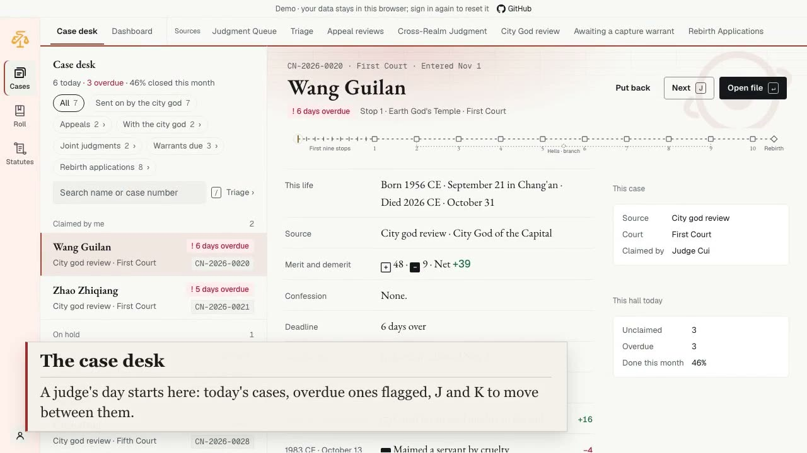
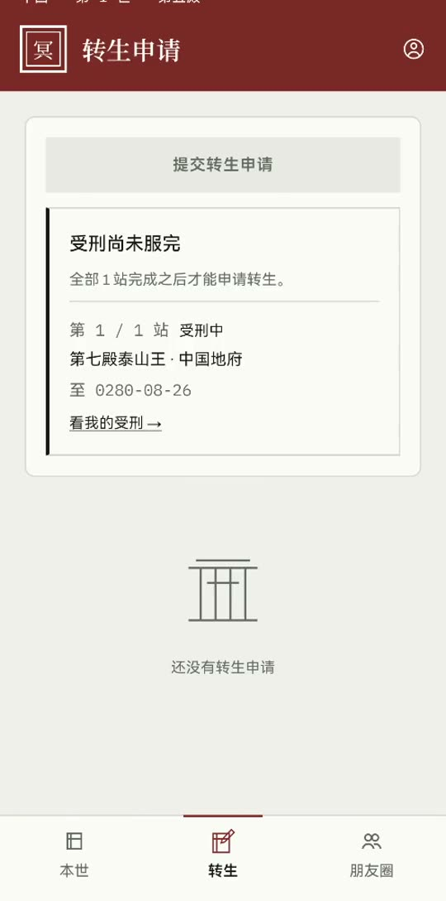
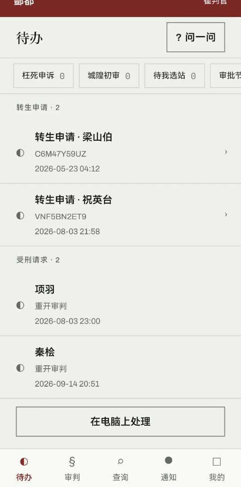
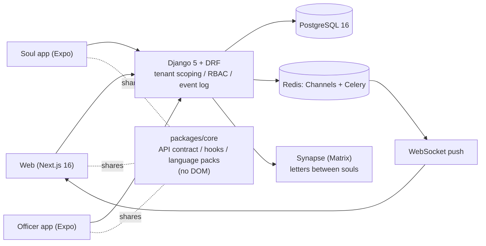

<p align="center"></p>

# SoulLedger

**English** | [中文](README.zh-CN.md)

[](https://soulledger.tardisyuan.ltd)
[](https://github.com/Tardisyuan/SoulLedger/actions/workflows/ci.yml)
[](LICENSE)

<sub>Django 5.2 · DRF · Channels · Next.js 16 · Expo 57 · PostgreSQL 16 · Redis · built with Claude Code</sub>

<p align="center"><a href="https://github.com/Tardisyuan/SoulLedger/releases/download/v1.0.0/SoulLedger-demo-en.mp4"></a><br>
<sub>▶ <a href="https://github.com/Tardisyuan/SoulLedger/releases/download/v1.0.0/SoulLedger-demo-en.mp4">Watch the two-minute walkthrough</a> (1:51, captions, no voice-over): the web console, both apps, and a real 404 / 403 when a judge reaches past their hall.</sub></p>

**A multi-tenant case-management and approval-workflow system**: Django 5 + DRF + Channels back end,
Next.js 16 web console, and two Expo (React Native) apps. It has tenant isolation, role-based access,
configurable multi-step approvals, real-time events and an audit trail.

The demo domain is afterlife judgment in four mythologies: Chinese, European, Egyptian and Greek. It was
chosen because their four rule sets cannot share one data model, so the system has to model real
differences instead of reskinning one schema.

Then try it yourself: **[live demo](https://soulledger.tardisyuan.ltd)**, no sign-up, one click per role. It is
the front end on recorded data, and every sign-in starts over.

**Contact**: open to full-stack roles, and to consulting on multi-tenant / approval-workflow systems.
Write to [tardisyuan@gmail.com](mailto:tardisyuan@gmail.com?subject=SoulLedger). One line is enough.

<p align="center">
  <a href="frontend/public/demo-videos/app-soul.mp4"></a>
  &nbsp;
  <a href="frontend/public/demo-videos/app-officer.mp4"></a>
</p>

**About AI.** Most of the code in this repository was written by Claude Code, not typed by me line by
line: about four in five commits carry a `Co-Authored-By: Claude` line (`git log` gives the exact count).
So the code alone says little about what I did. What follows is what I decided, and each item points to a
record in this repository, so you can check it without taking my word for it:

1. **I postponed my own first choice once the cost was worked out.** I wanted one database per tenant:
   four civilizations as four separate worlds. Costed on the code, it meant sagas with compensation for
   every cross-tenant judgment, giving up foreign keys across tenants, and routing on every query, for a
   workload that did not exist yet. So the system splits by business domain first. I still want the
   per-tenant split; it waits for a measured trigger, and new code is already written to its constraints
   ([ADR 0004](docs/adr/0004-split-by-domain-not-by-tenant.md),
   [the design notes](docs/ARCHITECTURE-soul-app-and-domain-split.md)).
2. **I did not trust "done".** On 2026-05-30 a report in this repository declared the code "Production
   Ready". On 2026-08-07 an audit of the same code found four critical tenant-isolation gaps. The report
   is still here, marked superseded ([`PRODUCTION_READINESS_REPORT.md`](docs/PRODUCTION_READINESS_REPORT.md)).
   I started that audit: instead of taking the report's word for it, I had the AI check every view, tenant
   by tenant.
3. **I turned each lesson into a check that goes red.** Tenant scoping was consolidated behind one
   function with a contract test over every ViewSet (2026-08-14,
   [ADR 0001](docs/adr/0001-tenant-isolation-in-the-view-layer.md)). The suite runs on real PostgreSQL as
   well as SQLite ([ADR 0003](docs/adr/0003-gates-select-tests-and-run-remotely.md)). The rule "no claim of *fixed* without the command, its exit
   code and the passed count" is written into the agents' instructions.

Three questions I'd like to be asked:

- Why does a merit recalculation that changes nothing write no event, and what would it cost if it did?
- A judge seals a case and regrets it. When can the seal still be withdrawn, and why does the window
  close on an event, not on a clock?
- What did SQLite let through that PostgreSQL caught on the first run?

## Three things worth a look

1. **Isolation and consistency are pinned by tests, not by discipline.** Tenant scoping goes through one
   function, and a contract test checks every ViewSet against it
   ([ADR 0001](docs/adr/0001-tenant-isolation-in-the-view-layer.md),
   [`core/tenant.py`](backend/apps/core/tenant.py)). The event log is written in the business transaction,
   so a failed write rolls the whole operation back
   ([ADR 0002](docs/adr/0002-event-log-in-the-business-transaction.md)).
2. **Gates that make green mean something.** A push runs only the tests the change can reach, on a
   separate build machine. Real PostgreSQL is its own path, for what SQLite hides: row locks, column
   widths, aborted transactions. Every new check is shown to go red before it is trusted
   ([ADR 0003](docs/adr/0003-gates-select-tests-and-run-remotely.md),
   [quality evidence](docs/portfolio/QUALITY-EVIDENCE.md)).
3. **Four rule sets, four models.** Chinese is a signed running account. Egyptian is a threshold test
   against a feather. European is two quantities that do not offset each other. Greek is a procedure, not
   a number. The code refuses to flatten them ([`ledger/readings.py`](backend/apps/ledger/readings.py)).

**Go deeper**: [How I built this](docs/portfolio/HOW-I-BUILT.md) ·
[API reference](https://soulledger.tardisyuan.ltd/api-docs) ·
[quality evidence](docs/portfolio/QUALITY-EVIDENCE.md) ·
[architecture decision records](docs/adr/README.md) ·
[development guide](docs/DEVELOPMENT.md) · [demo deployment](docs/DEPLOYMENT-demo.md)

## The domain, translated

| In the demo | General concept | Code (`backend/apps/`) |
|---|---|---|
| A hall / an underworld | Tenant | `tenants/`, `core/tenant.py` |
| Soul | Case subject / customer | `souls/` |
| Judgment | Case | `judgment/` |
| Judge, officer | Case worker / approver | `authentication/`, `perm/` |
| Passing hall by hall | Multi-step approval | `workflow/` |
| Cross-realm dispatch, joint judgment | Cross-tenant transfer and joint approval | `dispatch/` |
| Merit ledger | Per-tenant scoring rules | `ledger/` |
| Death registration | Intake API for external systems + HMAC webhooks | `death_sync/` |
| Soul app | Customer self-service app | `mobile/` |

## Architecture



| Area | What it covers | Code (`backend/apps/`) |
|---|---|---|
| Case pipeline | Judgment, disposition, reincarnation; correction of a closed case | `judgment/`, `disposition/`, `reincarnation/`, `souls/` |
| Approval workflows | Multi-node flows with templates, versions, per-node timeouts | `workflow/` |
| Cross-tenant transfer | Moving a case between tenants, through approval | `dispatch/` |
| Access control | Six roles, codename permissions, row and field scopes | `perm/`, `authentication/` |
| Events and realtime | Event bus, WebSocket push, tenant webhooks, audit log | `events/`, `notifications/`, `audit/` |
| External intake | API-key registration (single or batch), signed webhooks | `death_sync/` |
| Messaging and social | Private letters over Matrix (not end-to-end encrypted), posts and moderation | `chat/`, `social/` |
| Assistant | Read-only Q&A for souls and officers; tool calls cannot choose whose data they read | `soul_assist/` |
| Accounts | Officer and soul sign-in, two-step verification, face / fingerprint sign-in in the app | `authentication/`, `soul_accounts/` |

The details (tenancy model, roles, event routing, the state machine, the API map) are in the
[development guide](docs/DEVELOPMENT.md#architecture).

## Why the four civilizations are not one system

Most "multi-culture" demos pick one mechanic and restyle it. This one does not:

| Civilization | What its ledger actually says | Shape of the answer |
|---|---|---|
| **Chinese** | A cumulative account (功過格). Merit and demerit offset; the running total *is* the verdict. | One signed number |
| **Egyptian** | The heart is weighed once against Ma'at's feather and must be "not heavier than" it. Good deeds lighten the heart instead of earning a separate credit. | Pass/fail against a fixed weight |
| **European** | *Culpa* (guilt) and *poena* (penalty after absolution) do not reduce each other, and no data here can honestly derive poena. | Two independent quantities, one marked unavailable |
| **Greek** | Plato's two myths disagree, so 21 of the 23 transcribed articles are rules of the court, not offences. | A procedure, not a quantity |

A soul whose tenant has no civilization gets no reading at all: an explicit refusal, not a fallback to
somebody else's arithmetic. The web page renders each shape differently
([`SoulReadingPanel.tsx`](frontend/src/components/souls/SoulReadingPanel.tsx)).

## Quick start

Python 3.11 (with `uv`) and Node.js ≥ 20.9 (`.nvmrc`). No Docker, PostgreSQL or Redis needed for this path.

```bash
# back end: SQLite fallback, http://localhost:8000/api/v1/
cd backend && cp .env.example .env
uv venv --python 3.11 .venv
uv pip install --python .venv/bin/python --no-deps -r requirements.lock -r requirements-dev.txt
.venv/bin/python manage.py migrate
.venv/bin/python manage.py seed_tenants && .venv/bin/python manage.py seed_mythology  # the four halls
DEBUG=true .venv/bin/python manage.py seed_dev_users   # one sign-in per role, printed; refuses unless DEBUG
.venv/bin/python manage.py runserver

# web, from the repository root: http://localhost:3333
npx -y npm@11 ci && git checkout -- package-lock.json
npm run dev --workspace frontend
```

Open <http://localhost:3333> and sign in with any of the five officer accounts `seed_dev_users` printed
(the sixth is for the soul app). The two apps, Docker
and the full test commands are in the [development guide](docs/DEVELOPMENT.md).

## Tests and CI

Test counts, measured 2026-11-06
([`landing-stats.json`](frontend/src/config/landing-stats.json); they go stale, so trust the latest run):
back end 9,243 · web 5,677 · soul app 1,204 · officer app 1,095 · E2E about 270.

- **On every pull request**: static checks and a smoke test (`pr-checks.yml`).
- **Daily on main**: the full suite in `ci.yml`. That means real PostgreSQL with a coverage floor, three
  browser engines, a real Synapse, and pip and npm audit. The badge above is that run.
- **Before a push**: the maintainer's local gate, `scripts/run-gates.sh`.

What each command runs, and three cases where a guard was broken on purpose to prove it fails, are on the
[quality evidence](docs/portfolio/QUALITY-EVIDENCE.md) page.

## Security

Officer, soul and external credentials are separate, and none is accepted in another's place. Other
measures: RBAC with row and field scopes, two-step verification (TOTP plus recovery codes), Fernet
encryption for secrets and personal data, Redis rate limiting, SSRF checks on webhook URLs, and an audit
trail on every write.

Known gaps are stated, not hidden. For example, an API key's `rate_limit_per_hour` is stored but not
enforced. The list and how to report a problem are in [`SECURITY.md`](SECURITY.md).

## Status

A personal project. It has never been deployed for real users and makes no uptime or compatibility
promise. It is not a drop-in library either: the approval engine is tied to the demo domain.
`ApprovalWorkflow` has a foreign key to `souls.Soul` and a one-to-one link to `judgment.Judgment`
([`workflow/models.py`](backend/apps/workflow/models.py)), and case types are an enum of the four
mythologies. Reusing the engine for your own cases means replacing those two links with your own case
model and rewriting the case-type enum. The production compose file, health checks and CI exist because doing them properly was part of
the exercise. `git log` is the accurate history; [`docs/MILESTONES.md`](docs/MILESTONES.md) lags it.

## Contributing

Pull requests are welcome. Small ones are best: documentation fixes, translations, corrections to the
mythology research, and bug fixes with a reproduction. Open an issue before anything large.
[`CONTRIBUTING.md`](CONTRIBUTING.md) has the workflow and the rules for AI-assisted PRs. The maintainer
works alone and usually replies within a week. Looking for a place to start? Try a
[good first issue](https://github.com/Tardisyuan/SoulLedger/labels/good%20first%20issue).

## Credits

The menu and permission design draws on [Snowy](https://github.com/xiaonuobase/Snowy) (Apache-2.0). Code,
tests and docs were written with [Claude Code](https://claude.com/claude-code), and the interface was
designed with Claude Design. Fonts, libraries, literature and services are listed on the app's About page
(data in [`packages/core/src/config/credits.ts`](packages/core/src/config/credits.ts)).

## Contact

Maintainer: [@Tardisyuan](https://github.com/Tardisyuan) · [tardisyuan@gmail.com](mailto:tardisyuan@gmail.com?subject=SoulLedger)

Open to full-stack roles, and to consulting on multi-tenant / approval-workflow systems. If you need this
kind of system built, or want to talk about any decision above, write one line.

## License

[Apache-2.0](LICENSE). Third-party notices are in [`NOTICE`](NOTICE).
