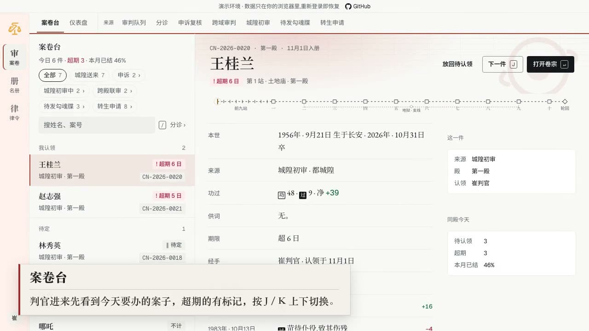
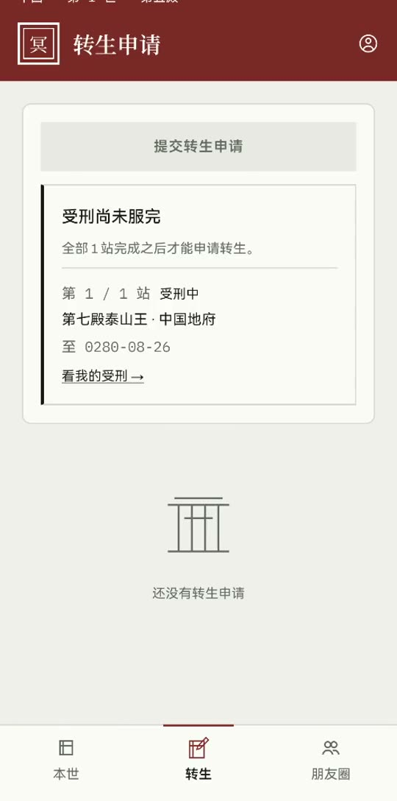
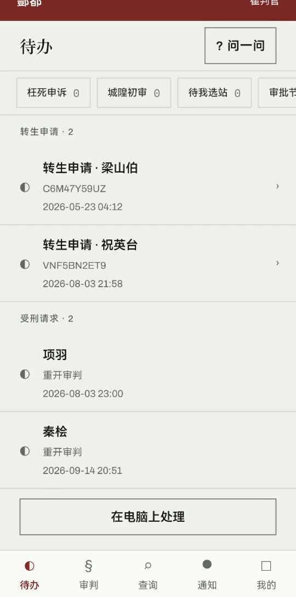
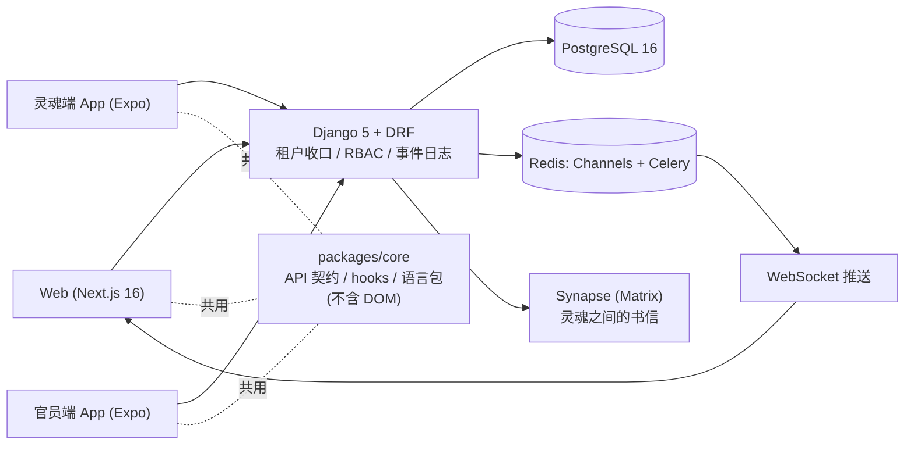

<p align="center"></p>

# SoulLedger

[English](README.md) | **中文**

[](https://soulledger.tardisyuan.ltd)
[](https://github.com/Tardisyuan/SoulLedger/actions/workflows/ci.yml)
[](LICENSE)


[](https://claude.com/claude-code)

<p align="center"><a href="https://github.com/Tardisyuan/SoulLedger/releases/download/v1.0.0/SoulLedger-demo-zh.mp4"></a><br>
<sub>▶ <a href="https://github.com/Tardisyuan/SoulLedger/releases/download/v1.0.0/SoulLedger-demo-zh.mp4">看两分钟演示视频</a>(1:51,只有字幕和背景音乐):网页控制台、两个 App,以及判官越过本殿去取数据时真实的 404 / 403。</sub></p>

**一套多租户案件管理与审批流系统。**技术栈是 Django 5 + DRF + Channels 后端、Next.js 16 网页后台和两个 Expo（React Native）App。系统做了这些：
- 租户隔离、角色权限
- 可配置的多级审批
- 实时事件
- 审计

演示用的业务是四种神话的「死后审判」：中国、欧洲、埃及、希腊。选它是因为四套规则在结构上互不兼容，没法用同一个数据模型换皮，系统只能把差异真正建模出来。

**[▶ 在线演示](https://soulledger.tardisyuan.ltd)**：不用注册，每个角色一键进入。这是纯前端版本，数据是录好的，每次登录回到原样。· **[API 参考](https://soulledger.tardisyuan.ltd/api-docs)**

**联系**：在找全栈岗位，也接多租户 / 审批流系统的咨询。邮箱 [tardisyuan@gmail.com](mailto:tardisyuan@gmail.com?subject=SoulLedger)，一句话就够。

<p align="center">
  <a href="frontend/public/demo-videos/app-soul.mp4"></a>
  &nbsp;
  <a href="frontend/public/demo-videos/app-officer.mp4"></a>
</p>

**关于 AI。**这个仓库的大部分代码是 Claude Code 写的，不是我逐行手写的：大约五个提交里有四个带
`Co-Authored-By: Claude`（准确数字以 `git log` 为准）。所以光看代码，看不出我做了什么。下面是我做的决定，每一条都指向仓库里的记录，
不用信我的话也能核对：

1. **算清代价后，我把自己的首选往后放了。**我原本想按租户分库：四种文明，四个独立的世界。在代码上算下来，
   每次跨殿审判都要变成带补偿的 saga，跨租户外键要拆，每条查询都要路由，而这样的负载当时还不存在。
   所以先按业务域拆。分库没有取消：等量到触发条件再做，新代码已经按分库的约束写
   （[ADR 0004](docs/adr/0004-split-by-domain-not-by-tenant.md)、[设计稿](docs/ARCHITECTURE-soul-app-and-domain-split.md)）。
2. **不信「已完成」。**2026-05-30，仓库里一份报告宣称「Production Ready」。2026-08-07，对同一份代码的审计
   找出 4 个严重的租户隔离缺口。那份报告还留着，标了「已作废」（[`PRODUCTION_READINESS_REPORT.md`](docs/PRODUCTION_READINESS_REPORT.md)）。那次审计是我发起的：我没有采信那份报告，而是让 AI 按租户逐个视图去查。
3. **把教训变成会变红的检查。**
   - 2026-08-14，租户过滤收口成一个函数，并用契约测试逐个检查 ViewSet（[ADR 0001](docs/adr/0001-tenant-isolation-in-the-view-layer.md)）。
   - 测试同时跑真 PostgreSQL 和 SQLite（[ADR 0003](docs/adr/0003-gates-select-tests-and-run-remotely.md)）。
   - 「没有命令、退出码、通过数，就不许说已修复」写进了给 AI 的规则。

希望被问到的三个问题：

- 功过重算算出来分数没变时，为什么不写事件？要是写了，代价是什么？
- 判官落了印又后悔了。什么时候还能撤回？为什么撤回窗口按事件关，不按时间关？
- SQLite 放过了什么，而 PostgreSQL 第一次跑就抓到了？

## 三个值得看的地方

1. **隔离与一致性靠测试钉住，不靠自觉。**
   - 租户过滤收口在一个函数，契约测试逐个检查每个 ViewSet。见 [ADR 0001](docs/adr/0001-tenant-isolation-in-the-view-layer.md) 和 [`core/tenant.py`](backend/apps/core/tenant.py)。
   - 事件日志写在业务事务里，写不进去就整笔回滚。见 [ADR 0002](docs/adr/0002-event-log-in-the-business-transaction.md)。
2. **门禁让「绿」可信。**
   - 推送时只跑改动能影响到的测试，整轮在独立构建机上跑。
   - SQLite 看不见的问题另走真 PostgreSQL：行锁、列宽、事务中止。
   - 新检查必须先证明会变红，才信它的绿。见 [ADR 0003](docs/adr/0003-gates-select-tests-and-run-remotely.md) 和[质量证据](docs/portfolio/QUALITY-EVIDENCE.md)。
3. **四套规则，四个模型。**中国是带符号的累积账户，埃及是对羽毛的阈值检验，欧洲是两个互不削减的量，希腊是一段程序而不是一个数。代码拒绝把它们抹平，见 [`ledger/readings.py`](backend/apps/ledger/readings.py)。

**想深入**：[我怎么做的这个项目](docs/portfolio/HOW-I-BUILT.md) · [质量证据（英文）](docs/portfolio/QUALITY-EVIDENCE.md) ·
[架构决策记录（英文）](docs/adr/README.md) · [开发指南（英文）](docs/DEVELOPMENT.md) · [演示站部署](docs/DEPLOYMENT-demo.md)

## 题材词对照

| 演示里叫 | 通用概念 | 代码（`backend/apps/`） |
|---|---|---|
| 殿 / 冥界 | 租户 | `tenants/`、`core/tenant.py` |
| 灵魂 | 案件主体 / 客户 | `souls/` |
| 审判 | 案件 | `judgment/` |
| 判官、官员 | 经办人 / 审批人 | `authentication/`、`perm/` |
| 逐殿过堂 | 多级审批 | `workflow/` |
| 跨域调度、会审 | 跨租户移交与联合审批 | `dispatch/` |
| 功过账簿 | 按租户可换的计分规则 | `ledger/` |
| 死亡登记 | 外部系统进件 API + HMAC webhook | `death_sync/` |
| 灵魂端 App | 客户自助端 | `mobile/` |

## 系统架构



| 业务域 | 做什么 | 代码（`backend/apps/`） |
|---|---|---|
| 案件流水线 | 审判、处置、轮回；已结案件的更正 | `judgment/`、`disposition/`、`reincarnation/`、`souls/` |
| 审批流程 | 多节点审批，含模板、版本、节点超时 | `workflow/` |
| 跨租户移交 | 案件在租户之间转移，走审批 | `dispatch/` |
| 权限 | 六种角色、权限码、行级与字段级范围 | `perm/`、`authentication/` |
| 事件与实时 | 事件总线、WebSocket 推送、租户 webhook、审计日志 | `events/`、`notifications/`、`audit/` |
| 外部进件 | API Key 登记（单条或批量）、签名 webhook | `death_sync/` |
| 书信与朋友圈 | Matrix 私信（不是端到端加密）、帖子与审核 | `chat/`、`social/` |
| 助手 | 灵魂端与官员端的只读问答；工具调用选不了读谁的数据 | `soul_assist/` |
| 账号 | 官员与灵魂登录、两步验证、App 内面容 / 指纹登录 | `authentication/`、`soul_accounts/` |

租户模型、角色、事件路由、状态机和 API 一览见[开发指南](docs/DEVELOPMENT.md#architecture)。

## 四种文明为什么不是同一套系统

大多数「多文明」演示挑一套机制再换皮，这里没有：

| 文明 | 账簿真正说的是什么 | 答案的形状 |
|---|---|---|
| **中国** | 累积账户（功過格）。功与过相互抵消，运行总额本身就是结论。 | 一个带符号的数 |
| **埃及** | 心脏与玛特羽毛称量一次，必须「不重于」它。善行减轻心脏，不另记功德。 | 相对固定砝码的通过 / 不通过 |
| **欧洲** | *culpa*（罪责）与 *poena*（赦罪后仍需的补赎）互不削减，而本系统没有任何数据能诚实地推出 poena。 | 两个独立量，其中一个标为不可得 |
| **希腊** | 柏拉图的两个神话本身不一致，所以 23 条语料里 21 条是庭规，不是罪名。 | 一段程序，而不是一个量 |

灵魂所属租户没有映射到任何文明时，系统不给读数：这是一次带理由的拒绝，不会借用别人的算术。网页按读数的形状分别渲染，见 [`SoulReadingPanel.tsx`](frontend/src/components/souls/SoulReadingPanel.tsx)。

## 快速启动

需要 Python 3.11（配 `uv`）和 Node.js ≥ 20.9（见 `.nvmrc`）。这条路径不需要 Docker、PostgreSQL 或 Redis。

```bash
# 后端，回落 SQLite：http://localhost:8000/api/v1/
cd backend && cp .env.example .env
uv venv --python 3.11 .venv
uv pip install --python .venv/bin/python --no-deps -r requirements.lock -r requirements-dev.txt
.venv/bin/python manage.py migrate
.venv/bin/python manage.py seed_tenants && .venv/bin/python manage.py seed_mythology  # 四个殿
DEBUG=true .venv/bin/python manage.py seed_dev_users   # 每个角色一个可登录账号，打印出来；不开 DEBUG 不肯跑
.venv/bin/python manage.py runserver

# 网页，在仓库根目录：http://localhost:3333
npx -y npm@11 ci && git checkout -- package-lock.json
npm run dev --workspace frontend
```

打开 <http://localhost:3333>，用 `seed_dev_users` 打印的五个官员账号之一登录（第六个是灵魂端 App 的）。以下内容见[开发指南](docs/DEVELOPMENT.md)（英文）：
- 两个 App 的构建；
- Docker；
- 完整的测试命令。

## 测试与 CI

测试数量（2026-11-06 读数，来源 [`landing-stats.json`](frontend/src/config/landing-stats.json)；数字会过期，以最近一次运行为准）：后端 9,243 · 网页 5,677 · 灵魂端 App 1,204 · 官员端 App 1,095 · E2E 约 270。

- **每个 PR**：静态检查加冒烟测试（`pr-checks.yml`）。
- **每天在 main 上**：`ci.yml` 跑全套。包括带覆盖率下限的真 PostgreSQL、三种浏览器引擎、真 Synapse，以及 pip 与 npm audit。上面的徽章显示的就是这一次运行。
- **推送前**：维护者本地的门禁 `scripts/run-gates.sh`。

每条命令跑什么、三次「故意把守护对象改坏、证明守卫会变红」的记录，见[质量证据](docs/portfolio/QUALITY-EVIDENCE.md)。

## 安全

- 官员、灵魂、外部系统三类凭据分开，互不通用。
- RBAC 带行级与字段级范围。
- 两步验证：TOTP 加恢复码。
- 密钥与个人数据用 Fernet 加密。
- Redis 限流。
- webhook 地址做 SSRF 校验。
- 所有写操作留审计。

已知缺口写明，不藏。例如 API Key 的 `rate_limit_per_hour` 只存不限。完整清单和报告方式见 [`SECURITY.md`](SECURITY.md)。

## 状态

这是个人项目，从未给真实用户部署过，不承诺可用性和向后兼容。生产用的 compose 文件、健康检查和 CI 存在，是因为把它们做对本来就是练习的一部分。准确的历史以 `git log` 为准，[`docs/MILESTONES.md`](docs/MILESTONES.md) 落后于它。

## 参与

欢迎 PR，小的最好：
- 文档勘误
- 翻译
- 神话考据纠错
- 带复现步骤的缺陷修复

大改动请先开 issue 讨论。流程和 AI 辅助 PR 的规矩见 [`CONTRIBUTING.md`](CONTRIBUTING.md)。维护者一个人，通常一周内回复。想找个地方上手，可以从 [good first issue](https://github.com/Tardisyuan/SoulLedger/labels/good%20first%20issue) 开始。

## 致谢

- 菜单与权限设计参考了 [Snowy](https://github.com/xiaonuobase/Snowy)（Apache-2.0）。
- 代码、测试和文档用 [Claude Code](https://claude.com/claude-code) 协作完成，界面用 Claude Design 设计。
- 字体、开源软件、文献与服务的完整清单在 App 的「关于」页，数据在 [`packages/core/src/config/credits.ts`](packages/core/src/config/credits.ts)。

维护者：[@Tardisyuan](https://github.com/Tardisyuan) · [tardisyuan@gmail.com](mailto:tardisyuan@gmail.com?subject=SoulLedger)

## 许可证

[Apache-2.0](LICENSE)。第三方声明见 [`NOTICE`](NOTICE)。
